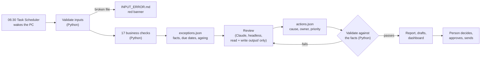

# Solar Job Exceptions Checker

A daily exceptions review for a UK solar PV and battery installer. Every morning it reconciles the job tracker,
installers' records, supplier invoices, the agreed price list and the compliance documents, and gives the office a
prioritised list of what is stuck, mismatched, non-compliant or overcharged, with an owner, a due date and a drafted
chase for each. It finds problems in days, before a customer, the DNO or an MCS assessor does.

Built by Neil with [Claude Code](https://claude.com/claude-code) as a Claude Skill. Python establishes the facts;
Claude provides the judgement; a person makes the decisions. All data in this repository is synthetic.

**Live dashboard (sample run):** https://neilncs.github.io/Job-Exception-Checker/


---

## Contents
1. [The problem](#the-problem)
2. [What it delivers](#what-it-delivers)
3. [How it works](#how-it-works)
4. [What it checks](#what-it-checks)
5. [Controls: where people stay in charge](#controls-where-people-stay-in-charge)
6. [Analytics](#analytics)
7. [Expected impact](#expected-impact)
8. [Evidence it works](#evidence-it-works)
9. [Running it](#running-it)
10. [Methods and tools](#methods-and-tools)
11. [Limitations and next steps](#limitations-and-next-steps)
12. [The same approach in e-commerce fulfilment](#the-same-approach-in-e-commerce-fulfilment)

---

## The problem

On domestic and small commercial solar jobs, delivery information lives in five places that drift apart:

| Source | Holds | Typical failure |
|---|---|---|
| Job tracker | Stage dates from contract to handover | Stage not updated; dates typed wrong |
| Installation records | What the team actually fitted | Kit substituted on site, never fed back |
| Supplier invoices | What we're being charged | List price instead of agreed price; duplicates |
| Agreed price list | What we should pay | Not shared with the supplier's billing team |
| Compliance folder | MCS, EIC, G98/G99, warranties, handover pack | Job closed before the paperwork is filed |

Cross-checking them by hand is slow, so it gets sampled or left to month end. The costly failures surface late: a G99
job energised before DNO approval, an MCS certificate missed, scaffold hire paid twice, a tracker that says twelve
panels when ten were fitted.

## What it delivers

Every working day, before 08:00:

- **A dashboard** (`output/dashboard.html`, opens in any browser) showing status, today's decisions and priority
  actions, root causes, workload by owner, money at risk and how long exceptions have been open.
- **A report** (`exceptions_report.md`) in the order a manager reads it: decisions, priority actions, position, root
  causes with one upstream fix each, then the full register.
- **Draft chase emails**, one per supplier or team, quoting the references and both values that disagree. Nothing is sent.
- **A run log** showing new, carried-over and closed exceptions, so the trend towards zero can be tracked.

## How it works



The design rule is **facts from code, judgement from Claude**:

| Python (deterministic, tested) | Claude (judgement, validated) |
|---|---|
| Validates every file, column, date and number | Classifies each exception by root cause and owner |
| Runs 17 business checks; every comparison, date gap and £ total | Spots patterns across jobs (one supplier, one installer team) |
| Severity, due date and days open from `config/rules.yaml` | Ranks actions: compliance, customer delay, money, data |
| Tracks new, carried-over and closed exceptions | Proposes one upstream fix per root cause |
| Validates Claude's output against the facts | Writes the report and the chase emails |

Arithmetic never depends on a language model, so the same data always gives the same exceptions, and that can be
tested. Claude's output is structured (`actions.json`) and checked by code: it must cover every exception exactly
once, using fixed lists of causes and owners, or the run is retried and then marked failed.

## What it checks

| Group | Checks |
|---|---|
| **A. Flow** | A1 stuck in a stage beyond its allowance · A2 stage reached with no date · A3 dates out of order (e.g. G99 installed before DNO approval) |
| **B. Tracker vs installation** | B1 panel count · B2 panel model · B3 inverter · B4 battery · B5 kWp (panels × watts) · B6 install or commissioning date · B7 no installation record |
| **C. Compliance** | C1 G98/G99 notification, MCS certificate or handover pack overdue after commissioning · C2 job marked complete with documents missing |
| **D. Supplier invoices** | D1 price above agreed beyond tolerance · D2 duplicate line · D3 invoice for an unknown job · D4 more invoiced than installed · D5 item not on the price list |
| **X. Data quality** | X1 bad or duplicate source record. Broken files stop the run with a clear message; bad rows are reported and quarantined so they can't cause false alarms |

All thresholds (days per stage, post-commissioning deadlines, price tolerance, required documents, severities and
response times) are in one file, [config/rules.yaml](config/rules.yaml). Values are business settings to confirm;
anything with a regulatory basis is marked "check against current ENA/MCS guidance". Definitions, usual causes and
owners: [references/check_definitions.md](references/check_definitions.md).

## Controls: where people stay in charge

| The system does, unattended | A person does |
|---|---|
| Runs the checks and updates the log | Answers each decision (e.g. was that inverter swap approved?) |
| Classifies, prioritises, sets due dates | Reviews, edits and **sends** each draft |
| Drafts one chase per supplier or team | Fixes the source record; the next run confirms closure |
| Flags anything ambiguous as a decision | Owns the thresholds in `rules.yaml` |

These controls are enforced, not just written down:

- **Least privilege.** In the scheduled run, Claude Code starts with `--permission-mode dontAsk` and may only read
  files and write inside `output/`. It has no shell, no email and no access to `data/` or `config/`. The runner runs
  the checks itself before Claude starts.
- **Fail loudly.** Broken input stops the run and is never logged as a clean day. A failed or incomplete run writes
  `RUN_FAILED.md` and turns the dashboard amber. A stale report can't show green.
- **Nothing closes by assertion.** An exception closes only when the data is fixed and a later run stops finding it.

## Analytics

| Measure | Why it matters | Where |
|---|---|---|
| Open exceptions and trend | Whether the operation is getting on top of its backlog | Dashboard chart, `run_log.csv` |
| New / carried over / closed | Flow: are problems being closed as fast as they arise? | Dashboard, run log |
| Severity mix and decisions needed | What needs senior attention today | Dashboard headline |
| Past response target | Exceptions not actioned within 1, 3 or 5 working days | Dashboard, register |
| Ageing (0–1, 2–7, 8–30, 30+ days) | Problems that are being tolerated rather than fixed | Dashboard |
| Root causes, Pareto order | Which upstream fix removes the most exceptions | Dashboard, report §4 |
| Workload by owner | Who is carrying the load; where to support | Dashboard |
| Money at risk by supplier, % of spend checked | Supplier performance and credit to recover | Dashboard, report |
| Detection accuracy | Precision and recall against a seeded answer key | `output/test_results.md` |

## Expected impact

**Measured on the sample data**

| Measure | Result |
|---|---|
| Problems detected (recall) | 22 of 22 planted, 100% |
| False alarms (precision) | 0 on 19 clean jobs, 100% |
| Coverage | 100% of jobs and invoice lines, every working day |
| Time to produce the review | About 2 minutes unattended |
| Detection lag | Flagged on the first day past a limit (e.g. an MCS certificate on day 11 of a 10-day limit) |
| Money flagged | £3,889.80, 2.7% of £143,180.60 invoiced (planted problems, so not a real-world rate) |

**Estimated for a live operation of about 40 active jobs.** These figures use the assumptions shown. Replace them
with your own figures.

| Measure | Manual (assumed) | With the checker | Change |
|---|---|---|---|
| Time spent reconciling | 10 min per active job per week = 6.7 h/week | 15 min review per day = 1.25 h/week | **About 80% less** |
| Invoice lines checked | Sample of about 25% | 100% | **4× coverage** |
| Time to spot a missed deadline | Up to a week (weekly check) or month end | Next working day | **From days or weeks to under 1 day** |
| Compliance items found by an assessor first | Some | Flagged internally first | Fewer findings |

The financial case is `invoice spend × overcharge rate × share caught` plus the cost of compliance findings
avoided. Both depend on the business's own figures.

## Evidence it works

| Test | Result |
|---|---|
| `test_against_answer_key.py`: 40 synthetic jobs with 22 planted problems across every check | **22 / 22 caught, 0 false alarms** |
| Same test on three other random seeds | Pass each time |
| Thresholds tightened (2% to 1%, 10 days to 9): near-miss jobs must now trip | Both trip |
| `test_bad_input.py`: invalid dates, words in number fields, duplicate IDs, negative quantities, missing column, missing file, broken rules | **11 / 11** |
| `test_actions_validator.py`: Claude's output contract rejects incomplete or malformed classification | **10 / 10** |
| Forced stall of the review step | Stopped after the time limit, retried, then marked failed |
| Scheduled-run conditions (no `APPDATA`, clean environment) | Completes in about 80 to 170 seconds; source files unchanged |

## Running it

**Set up once** (Python 3.10+ and [Claude Code](https://claude.com/claude-code)):

```powershell
python -m pip install -r requirements.txt
```

**Day to day, nobody types into Claude:**

| To | Do |
|---|---|
| See this morning's results | Double-click **`Open dashboard.cmd`** |
| Refresh now | Double-click **`Run check now.cmd`** (about 2 minutes) |
| Run it every morning at 06:30 | `powershell -ExecutionPolicy Bypass -File scripts\register_task.ps1 -RunNow` (once) |
| Remove the schedule | `powershell -ExecutionPolicy Bypass -File scripts\register_task.ps1 -Remove` |

The schedule wakes the PC from sleep on mains power, runs at next start-up if it was missed, keeps the PC awake while
running, waits for the network, and limits each review attempt to 15 minutes with up to three attempts. On macOS or
Linux, use `scripts/run_daily.sh` from cron (`30 6 * * *`).

**For developers:**

```powershell
python scripts/run_checks.py --as-of 2026-11-23
```

```powershell
python scripts/test_against_answer_key.py
```

Open Claude Code in this folder and ask it to "run the solar job exceptions check" to run the full review
interactively. [PRESENTING.md](PRESENTING.md) covers where every output lives and how to demo it.

### Repository layout

```
SKILL.md                         the review procedure Claude follows
config/rules.yaml                every threshold and response time, in one place
references/                      check definitions, writing standards
templates/                       report and chase-email templates
scripts/run_checks.py            input validation and the 17 checks
scripts/validate_actions.py      validates Claude's classification against the facts
scripts/build_dashboard.py       builds output/dashboard.html
scripts/run_daily.ps1 / .sh      unattended runner
scripts/register_task.ps1        registers or removes the 06:30 task
scripts/generate_sample_data.py  synthetic data with planted problems and an answer key
scripts/test_*.py                answer-key, bad-input and output-contract tests
data/sample/                     the synthetic inputs
output/YYYY-MM-DD/               each day's facts, actions, report and drafts
output/run_log.csv               one row per day
```

## Methods and tools

**Methods**
- *Management by exception.* Report only what breaks a rule, with an owner and a due date.
- *Reconciliation and three-way match.* Price list against invoice against what was installed. Tracker against job sheet against document set.
- *Stage-gate service levels.* A time allowance per stage, and response targets per severity.
- *Root-cause analysis with Pareto ranking*, and one upstream fix per cause (error-proofing, as in Lean).
- *Human in the loop, least privilege and fail-closed design.*
- *Contract-validated AI output.* Structured JSON checked by code before anything is shown.
- *Seeded-defect testing.* A synthetic data set with a known answer key, near-miss cases and threshold mutation, measuring precision and recall.

**Tools.** Python 3 (standard library and PyYAML) · Claude Code (Skills, headless mode, permission controls) ·
PowerShell and Windows Task Scheduler · HTML and JavaScript (no framework, works offline) · Git and GitHub.

## Limitations and next steps

- Inputs are CSV exports. Next: read directly from the job-management, accounting and document systems' APIs.
- Bank holidays are not excluded from working-day targets.
- Thresholds are placeholders until confirmed against the business's own service levels and current ENA and MCS guidance.
- Next: weekly summary of which upstream fixes reduced exceptions; time-to-close per owner; a cloud-scheduled version that runs with the PC off.

## The same approach in e-commerce fulfilment

| Solar installer | E-commerce fulfilment |
|---|---|
| Job and its stages | Order: paid, picked, packed, shipped, delivered |
| Installation record | WMS or 3PL record of what was actually shipped |
| Agreed supplier price list | Carrier rate card |
| Days allowed per stage | SLAs: dispatch within 24 hours, deliver within 3 days |
| MCS, G98/G99, handover pack | Proof of delivery, customs documents, returns labels |
| Panel count mismatch | Short shipment or wrong SKU |
| Duplicate scaffold invoice | Carrier billing a parcel twice |
| Invoice for an unknown job | Carrier charge for an order that doesn't exist |
